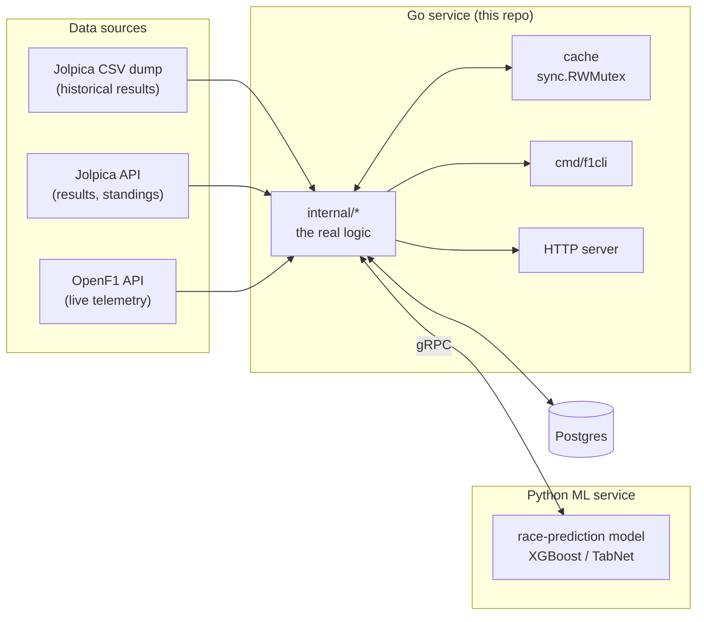

# f1-go

An F1 telemetry and race-prediction system written in Go.

It's a learning project. The goal is to become a better Go developer by building a real system piece by piece: a CLI, an HTTP API, a concurrent telemetry pipeline, and eventually a gRPC bridge to a Python model that predicts race results. The F1 data keeps it fun.

> **Status:** early. The CLI and the lap-data parser exist; most of the system is still planned. See the [roadmap](#roadmap).

## Where it's heading



The main design idea: data flows **into** the `internal/` packages, which hold all the logic and are fully testable, and **out** through thin front doors (the CLI or the HTTP server). The front doors don't know where the data came from, and the core doesn't know who's asking.

## Roadmap

The project is built in ten "laps", each one focused on a set of Go skills.

| Lap | What gets built | Go skills | Status |
| --- | --- | --- | --- |
| 1 | Workspace and project skeleton | Go basics, modules | ✅ Done |
| 2 | CSV stats CLI (wins per driver per season) and a timed trivia game | `flag`, `encoding/csv`, goroutines, channels, `select` | 🟡 In progress |
| 3 | HTTP server for lap data, Jolpica API client | `net/http`, `encoding/json`, `httptest` | 🟡 JSON parser done |
| 4 | OpenF1 telemetry client, worker pool, cache | `context`, `sync.WaitGroup`, `sync.RWMutex`, rate limiting | ⬜ Planned |
| 5 | ML feature engineering | Python, Pandas, FastF1 | ⬜ Planned |
| 6 | Race-prediction models | XGBoost / TabNet, validation | ⬜ Planned |
| 7 | Service contracts | gRPC, Protocol Buffers | ⬜ Planned |
| 8 | Go ↔ Python integration | gRPC client and server | ⬜ Planned |
| 9 | Containers and storage | Docker, Postgres | ⬜ Planned |
| 10 | Config and end-to-end test | secrets in `.env`, full container test | ⬜ Planned |

## What works today

- **`internal/parser`**: turns a lap's JSON telemetry payload into a typed `LapRecord` (driver, tyres, weather, sector times, corners), and parses lap-time strings like `"1:22.450"` into seconds. Table-driven tests included.
- **`cmd/f1cli`**: a CLI that validates its flags and reports every bad flag at once. The stats it will print (wins per driver for a season) are the current work.

## Getting started

Requires Go 1.26 or newer.

```sh
git clone https://github.com/masterchief117k/f1-go.git
cd f1-go
go test ./...
```

### The dataset

The CLI reads the [Jolpica](https://github.com/jolpica/jolpica-f1) F1 database dump, which isn't committed to this repo. To get it:

1. Download the CSV dump from <https://api.jolpi.ca/data/dumps/download/delayed/?dump_type=csv>.
2. Copy these tables into `data/jolpica/`, dropping the `formula_one_` prefix from each name: `season`, `round`, `session`, `sessionentry`, `roundentry`, `teamdriver`, `driver`, `team`, `circuit`.

### Running the CLI

Run it from the repo root:

```sh
go run ./cmd/f1cli -season 2021 -top 10
```

| Flag | Default | Meaning |
| --- | --- | --- |
| `-season` | `2022` | The season to look at (1950–2025 for now) |
| `-top` | `5` | How many drivers to show (1–22) |
| `-data` | `season.csv` | Data file inside `data/jolpica/` (this flag's design is still being decided) |

## Project layout

```
cmd/f1cli/          CLI entry point: flags, validation, wiring
internal/parser/    JSON telemetry → LapRecord, lap-time parsing
internal/api/       HTTP clients for Jolpica and OpenF1 (planned)
internal/telemetry/ ingest pipeline, worker pool, cache (planned)
internal/trivia/    timed trivia game (planned)
internal/predictor/ bridge to the Python ML service (planned)
data/jolpica/       the Jolpica CSV dump (not committed)
```

## Data sources

- [Jolpica-F1](https://github.com/jolpica/jolpica-f1): historical results and the successor to the Ergast API. The data is licensed [CC BY-NC-SA 4.0](https://creativecommons.org/licenses/by-nc-sa/4.0/). See [`data/MANIFEST.md`](data/MANIFEST.md) for which dump this project uses.
- [OpenF1](https://openf1.org): live and historical telemetry.

This is an unofficial project and isn't associated with Formula 1 or the FIA.
